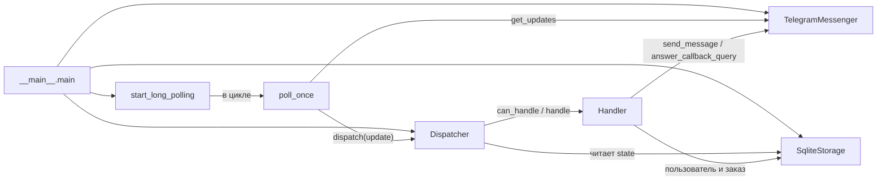

# unn-2026-sklyarov-test

Учебный бот для заказа пиццы в Telegram. Пользователь выбирает пиццу, размер и напиток кнопками.
Состояние заказа хранится в SQLite. Написан на чистом Python без runtime-зависимостей:
HTTP-запросы к Telegram Bot API идут через стандартный `urllib`, база — через `sqlite3`.

## Как устроен бот



- `bot/messenger.py` — абстрактный интерфейс `Messenger`.
- `bot/telegram_messenger.py` — реализация `Messenger` для Telegram Bot API.
- `bot/storage.py` — абстрактный интерфейс `Storage`.
- `bot/sqlite_storage.py` — реализация `Storage` на SQLite. При создании применяет `migrations/*.sql`.
- `bot/long_polling.py` — цикл long polling. Запрашивает `message` и `callback_query`.
- `bot/dispatcher.py` — цепочка обязанностей. Статус пользователя читается один раз перед проходом по обработчикам.
  `HandlerStatus.STOP` обрывает проход.
- `bot/handlers/` — обработчики, порядок в `get_handlers()`:
  - `update_logger.py` — пишет весь update в `telegram_updates` и передаёт дальше;
  - `ensure_user.py` — создаёт или обновляет пользователя и передаёт дальше;
  - `pizza_type.py` — выбор пиццы, а после `finished` начало нового заказа;
  - `pizza_size.py` — выбор размера;
  - `pizza_drink.py` — выбор напитка и итог заказа.

Шаги заказа: `waiting_for_pizza_type` → `waiting_for_pizza_size` → `waiting_for_drink` → `finished`.
Обычное сообщение повторяет клавиатуру текущего шага. Следующее событие после `finished` начинает новый заказ.

## Переменные окружения

| Переменная          | Обязательная | Описание                                                        |
|---------------------|--------------|-----------------------------------------------------------------|
| `TELEGRAM_TOKEN`    | да           | Токен бота, выдаёт [@BotFather](https://t.me/BotFather)         |
| `TELEGRAM_BASE_URL` | да           | Адрес Bot API, например `https://api.telegram.org`              |
| `DATABASE_PATH`     | нет          | Файл SQLite. По умолчанию `database.sqlite` в текущем каталоге  |
| `MIGRATIONS_DIR`    | нет          | Каталог SQL-миграций. По умолчанию `migrations`                 |

## Запуск

Нужен [uv](https://docs.astral.sh/uv/).

```sh
make install   # установить dev-зависимости (ruff, mypy)

# запустить бота
TELEGRAM_TOKEN=<токен> TELEGRAM_BASE_URL=https://api.telegram.org uv run python -m bot
```

Файл базы появляется рядом с каталогом `bot/`, в образ он не копируется. Остановка — `Ctrl+C`.

## Проверки

```sh
make check   # всё сразу: форматирование, линтер, типы, тесты
make test    # только тесты (unittest)
make ruff-cs-fix ruff-linter-fix   # автоисправление стиля и линтера
```

## Docker

При старте контейнера процесс создаёт `/data/database.sqlite`, если файла ещё нет, и выполняет SQL из `migrations/`. Повторный запуск не пересоздаёт таблицы.

```sh
make build
docker run --rm \
    -e TELEGRAM_TOKEN=<токен> \
    -e TELEGRAM_BASE_URL=https://api.telegram.org \
    -v pizza-data:/data \
    unn-2026-sklyarov-bot-test
```

Том на `/data` необязателен. С ним файл базы переживает перезапуск контейнера.
