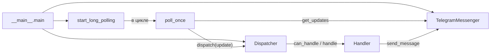

# unn-2026-sklyarov-test

Учебный эхо-бот для Telegram: отвечает пользователю тем же текстом, который получил.
Написан на чистом Python без runtime-зависимостей — HTTP-запросы к Telegram Bot API
делаются через стандартный `urllib`.

## Как устроен бот



- `bot/messenger.py` — абстрактный интерфейс `Messenger`: получить обновления и отправить сообщение.
- `bot/telegram_messenger.py` — реализация `Messenger` для Telegram Bot API.
- `bot/long_polling.py` — цикл long polling: `poll_once` запрашивает обновления,
  сдвигает `offset` и передаёт каждое обновление в `Dispatcher`.
- `bot/dispatcher.py` — паттерн «Цепочка обязанностей» (Chain of Responsibility):
  обновление проходит по обработчикам, пока один из них не вернёт `HandlerStatus.STOP`.
- `bot/handlers/` — обработчики. Новый обработчик наследуется от `Handler`
  и регистрируется в `get_handlers()` в `bot/handlers/__init__.py`.

## Переменные окружения

| Переменная          | Обязательная | Описание                                                        |
|---------------------|--------------|-----------------------------------------------------------------|
| `TELEGRAM_TOKEN`    | да           | Токен бота, выдаёт [@BotFather](https://t.me/BotFather)         |
| `TELEGRAM_BASE_URL` | да           | Адрес Bot API, например `https://api.telegram.org`              |

## Запуск

Нужен [uv](https://docs.astral.sh/uv/).

```sh
make install   # установить dev-зависимости (ruff, mypy)

# запустить бота
TELEGRAM_TOKEN=<токен> TELEGRAM_BASE_URL=https://api.telegram.org uv run python -m bot
```

Остановка — `Ctrl+C`.

## Проверки

```sh
make check   # всё сразу: форматирование, линтер, типы, тесты
make test    # только тесты (unittest)
make ruff-cs-fix ruff-linter-fix   # автоисправление стиля и линтера
```

## Docker

```sh
make build
docker run --rm \
    -e TELEGRAM_TOKEN=<токен> \
    -e TELEGRAM_BASE_URL=https://api.telegram.org \
    unn-2026-sklyarov-bot-test
```
